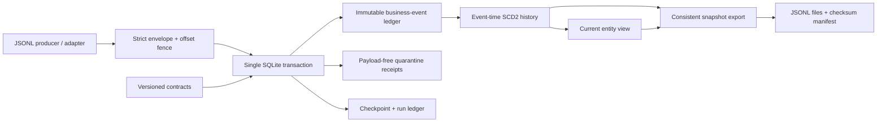

# LedgerFlow CDC

[](https://github.com/ManeeGit/ledgerflow-cdc/actions/workflows/ci.yml)


**A working data-engineering reliability reference for change-data-capture pipelines: transactional checkpoints, strict contracts, safe replay, event-time SCD2, and verifiable snapshots.**

Most pipeline demos show a happy-path insert. This project makes failure semantics the main feature: changed replays, poison records, out-of-order updates, concurrent writers, process crashes, schema evolution and interrupted exports have executable tests.

> **Scope:** production-oriented engineering patterns in a single-node reference implementation. This is not a deployed enterprise service, Kafka connector, distributed lakehouse, compliance certification or throughput guarantee. Read the [production-readiness checklist](docs/production-readiness.md) before adapting it to real data.

## What works

- **Atomic ingestion:** accepted events, quarantine receipts, transport offsets and run counters commit together, using SQLite WAL and `synchronous=FULL`.
- **Two-level idempotency:** identical records at existing offsets are replays; identical business events at new offsets are duplicates. Changed content at an old offset fails the entire batch.
- **Contiguous checkpoint fences:** missing offsets stop a batch before it can silently skip source data.
- **Immutable contracts:** exact types, required/nullable fields, enums, bounds, unknown-field rejection, and additive optional schema evolution.
- **Durable, payload-free quarantine:** a digest and safe reason code record invalid business data without persisting the rejected payload.
- **Event-time SCD2:** late arrivals reconstruct history deterministically; deletes, resurrection and same-time revisions are explicit.
- **Consistent snapshots:** a single read transaction, atomic directory publication, per-file SHA-256 and row counts, tamper detection and no intentional overwrite.
- **Operability:** JSON CLI, integrity audit, Prometheus text output, reproducible benchmark, runbook, non-root Dockerfile and multi-version CI.
- **No runtime dependencies or paid cloud accounts.** All fixtures are synthetic.

## Architecture



See [architecture and invariants](docs/architecture.md), [data contract](docs/event-contract.md), [operating runbook](docs/runbook.md), and [security policy](SECURITY.md).

## Quick start

Python 3.11+ on Linux/macOS is recommended. No service installation is needed.

```bash
git clone https://github.com/ManeeGit/ledgerflow-cdc.git
cd ledgerflow-cdc
python -m venv .venv
. .venv/bin/activate
python -m pip install .
python -m unittest discover -s tests -v
python scripts/demo.py
```

Or run directly from a checkout without downloading anything:

```bash
PYTHONPATH=src python -m unittest discover -s tests -v
PYTHONPATH=src python scripts/demo.py
```

The demo runs inside a temporary directory and removes only its own temporary artifacts. Its synthetic order arrives in revision order **1, 3, 2**, followed by a duplicate and an invalid negative amount:

```text
First ingestion: accepted=3, quarantined=1, duplicates=1, replays=0
Replay: accepted=0, quarantined=0, duplicates=0, replays=5
History: pending → paid → shipped
Audit: ok=true
Snapshot verification: ok=true
```

## End-to-end CLI

Run from the repository root after installation. These commands create local data only.

```bash
ledgerflow --db orders.db register --stream orders --version 1 examples/orders.contract.v1.json
ledgerflow --db orders.db ingest examples/orders.jsonl
ledgerflow --db orders.db status
ledgerflow --db orders.db history --stream orders --key order-001
ledgerflow --db orders.db current --stream orders
ledgerflow --db orders.db audit
ledgerflow --db orders.db metrics
ledgerflow --db orders.db export --stream orders snapshots/orders-001
ledgerflow verify snapshots/orders-001
```

Re-run ingestion to verify idempotence. Export destinations must be new. CLI success is exit `0`, invalid input/operational failure is `2`, and failed integrity verification is `3`. Quarantined business records are a successful durable ingestion outcome, so monitor the quarantine counters rather than relying on exit status alone.

## Correctness contract

| Situation | Behavior |
|---|---|
| Same offset, same canonical record | Replay; no business mutation |
| Same offset, changed record | Whole batch rolls back |
| Offset gap or invalid transport envelope | Whole batch rolls back |
| Valid envelope, unknown schema or invalid business data | Durable quarantine; checkpoint advances |
| Same event ID and normalized identity at a new offset | Duplicate; checkpoint advances |
| Reused event ID with changed identity | Quarantine `EVENT_ID_CONFLICT` |
| Same key/revision with another event ID | Quarantine `REVISION_CONFLICT` |
| Late effective timestamp | History recomputed in event-time order |
| Multiple revisions at identical effective time | Highest revision owns that interval; all events remain stored |
| Abrupt process death before commit | No partial checkpoint or business state |

“Replay” compares canonical JSON, not whitespace or input key order. Timestamp spellings are preserved in the transport hash; business identity uses UTC-normalized timestamps. This is **exactly-once application within this ledger**, not a claim of end-to-end exactly-once delivery across external systems.

## Verification

```bash
make check
PYTHONPATH=src python scripts/benchmark.py --events 10000
```

The initial local validation passed **60 tests with 96% measured statement coverage**, Ruff lint/format checks, Bandit source checks and a package wheel build/install. Tests include actual subprocess termination inside a transaction, multi-connection ingestion, 20 deterministic shuffled arrival orders, snapshot consistency during concurrent writes, export failure injection, schema boundary attacks, injection-shaped keys and payload-safe CLI errors. GitHub Actions tests Python 3.11/3.12/3.13, installs the package, runs the demonstration, and builds/smoke-tests the non-root container. A separate quality job enforces Ruff, Bandit and at least 90% statement coverage. See the live badge for CI status; workflow configuration alone is not evidence of a passing run.

An initial **local** Linux/Python 3.12 run processed 10,000 synthetic events in 1,000-event batches at approximately 24,800 events/second with WAL/FULL and a passing audit. This is one development-container observation, not a capacity promise. Run the benchmark on your storage and workload; SCD2 query/export cost, durability, key skew and contention differ from ingestion-only throughput.

## Container

```bash
docker build -t ledgerflow:local .
docker run --rm --read-only --cap-drop=ALL --security-opt=no-new-privileges ledgerflow:local --help
```

For persisted processing, mount a volume at `/data` writable by UID/GID `10001`, and mount synthetic inputs read-only. Do not use network filesystems for SQLite WAL. The image exposes no network port; authentication and authorization belong at the surrounding adapter/service boundary. The base image uses a maintained tag for this reference; production promotion should pin a scanned digest and maintain updates.

## Deliberate limits

- Single local database, one writer at a time; no HA, cross-region replication, managed backups or distributed transactions.
- JSONL adapter only. Source offsets must start at zero and be contiguous. Raw Kafka offsets may have gaps from compaction/transactions, so a Kafka adapter must define its own delivery-sequence mapping and durable source-offset mapping.
- Rejected payloads are intentionally not recoverable from the quarantine table. Retain the original source under your own retention/access policy, correct it, and send a new event at a new offset.
- No retention compaction: historical events, receipts and runs grow. No encryption at rest, tenant authorization, TLS endpoint, PII discovery or regulatory deletion workflow is implemented.
- Snapshot checksums detect accidental modification, not a malicious actor who can rewrite both data and manifest. Use externally signed manifests/object locking where needed.
- Intended for trusted local filesystem directories. Export locks coordinate this library's writers; hostile filesystem races are outside the threat model.

## Contributing

Read [CONTRIBUTING.md](CONTRIBUTING.md). Keep guarantees testable and documentation honest. A proposed source adapter should include replay, crash-recovery and offset-gap tests before adding infrastructure.

MIT licensed. Author: Maneesh Malepati.
